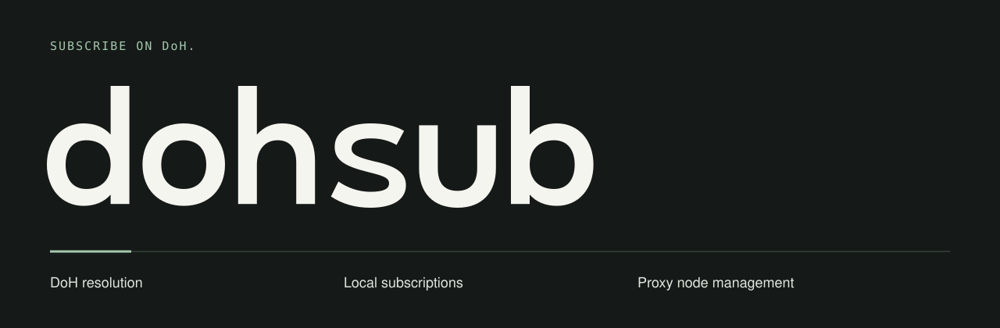
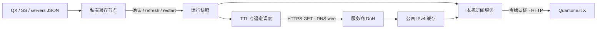

简体中文 · [English](README.md)

<p></p>

# dohsub

**私有域名解析，自动更新订阅。** 用 Rust 实现的本机常驻工具，把域名形式的 Shadowsocks 节点转为持续更新 IP 的 Quantumult X 本地订阅。



- 使用可配置的 HTTPS DoH 解析服务商私有域名，无须修改系统 DNS。
- 导入完整 QX 节点、`ss://` 链接或 servers JSON 数组，不依赖特定服务商客户端。
- 修改先保存，确认后再加载；有效 IP 尽量保持稳定，解析失败自动退避重试。
- 仅监听本机回环地址，订阅使用随机令牌；隐藏目录 `~/.dohsub/` 权限 700，私有文件权限 600。

## 安装

目标系统为 macOS/Linux、arm64/x86_64，需要 `curl`；源码构建需要 **Rust 1.94+**。本次仅在当前 Apple Silicon Mac 上验证，Linux 及旧系统兼容性尚未验证。

在本项目目录执行，无须 Homebrew：

```bash
./install.sh --source
export PATH="$HOME/.local/bin:$PATH"
export MANPATH="$HOME/.local/share/man:${MANPATH:-}"
```

也可以先构建，再安装可信的本地二进制：

```bash
cargo build --release --locked
./install.sh --binary ./target/release/dohsub --prefix "$HOME/.local"
```

`--binary` 信任提供的文件，不能证明下载来源。安装器会先准备二进制、手册和补全，再替换命令；保留 `bin/dohsub.previous`，安装后版本核验失败则恢复旧命令。多个配套资源不构成原子事务。

随项目提供的 **HEAD Formula** 从 master 分支构建：

```bash
brew install --HEAD leo1394/dohsub/dohsub
```

使用 `./install.sh --version X.Y.Z` 安装指定版本，或执行 `./install.sh` 安装最新稳定版。下载需要对应平台的二进制及同一版本的 `SHA256SUMS`；缺少发布文件时安装失败。

## 创建第一个订阅

需要可用的 DoH 地址，以及含真实加密方式和密码的完整节点配置。不要把密码、订阅令牌提交到仓库或发送到聊天。

```bash
dohsub config set --doh https://your-provider.example/dns-query
chmod 600 "$HOME/Downloads/nodes.txt"
dohsub import --file "$HOME/Downloads/nodes.txt"
dohsub start
dohsub copy-resource
```

`start` 校验 DoH 响应后启动后台进程，并打印**私有订阅地址**。`copy-resource` 把完整订阅配置行复制到剪贴板。粘贴到 QX 的 `[server_remote]`，保存并手动刷新订阅。生成的节点名称带 ` · AutoIP` 后缀；工具不会选择 QX 策略组或切换当前节点。

默认端口 **55355**。默认或缓存端口被占用时向上递增，例如其他本地服务正在使用该端口；显式 `start --port 55355` 遇到占用则失败。成功选中的端口会缓存。如果端口变化，请重新复制订阅配置行并更新 QX。

```bash
dohsub start --doh https://your-provider.example/dns-query --port 55356 --import nodes.json
dohsub config --list
dohsub config set --interface en0   # 可选：DoH 请求使用的出口网卡
dohsub config set --clear-interface
```

`config --list` 隐藏 URL 查询参数值。缓存配置的修改在下次启动或重启时生效。服务会在命令退出后继续运行，**不会自动注册开机或登录启动**。

## 常用命令

| 命令 | 行为 |
| --- | --- |
| `import --file FILE [-y]` | 从私有文件导入，逐项显示成功与失败 |
| `add [--domain HOST] [-y]` | 从剪贴板导入完整配置；全部成功后清空剪贴板 |
| `list` | 查看暂存节点、运行中发布数量及重试状态，不显示密码 |
| `refresh` | 加载暂存节点，并立即安排一轮 DNS 刷新；QX 仍需另外刷新 |
| `remove 'Example-US'` | 按原始名称删除、备份，运行中立即加载 |
| `restore` | 与上一次修改前的节点快照交换，运行中立即加载 |
| `restart` / `stop` | 仅管理 dohsub 后台进程 |
| `copy-resource` | 重新复制含私有令牌的本地订阅配置行 |
| `version` / `--version` | 固定两行版本和仓库地址 |
| `upgrade [-y]` | 查询 GitHub 稳定版，确认后更新受支持的安装 |
| `help config set` | 查看嵌套帮助，不初始化配置 |

按完整 tag 更新同名节点，其他已有节点保留；不同名称即使参数相同也保留，需要用 `remove` 明确删除。同一份输入中的重复 tag 会报失败。部分导入成功会保存合法节点，并返回退出码 **1**。绿色勾表示配置被接受；“已发布”表示取得公网 IPv4，都不表示已完成代理握手测试。

运行中导入会先保存，再询问是否立即加载。只有 `y`/`yes` 或 `-y` 会加载；空输入、EOF、非交互运行均仅保存。之后可执行 `refresh` 或 `restart`。`start --import FILE` 启动失败时，已接受的节点可能保留为暂存状态，不会误报服务启动成功。

[输入格式示例与架构](docs/design.md)。`restore` 只恢复节点，不恢复配置或 DNS 缓存。

## 资源与安全边界



使用阻塞 I/O，等待下一次 DNS 截止时间或控制请求；相同域名合并解析。读取订阅不触发 DNS 查询。只有到期解析时才短暂启动 `curl`，没有常驻 TLS 客户端进程。[调度与持久化说明](docs/design.md)。

当前仅支持 Shadowsocks、公网 IPv4，以及 RFC 8484 GET DNS-wire DoH 接口，保留 TLS 证书校验。工具不接管流量、不配置 TUN、不修改系统 DNS，也不修改 Tailscale。

节点和 DoH 地址存放在仅当前用户可读的明文文件中，并非 Keychain 或保险库。掌握订阅地址或当前系统账号的人能读取节点密码，请勿把地址贴进日志。HTTP 拒绝外部 Host/Origin，不适合直接暴露到局域网或公网。解析失败时仅发布仍有可用地址的节点；全部不可用时返回 HTTP 503，让客户端保留旧订阅。之前解析的 IP 最多允许在 TTL 过期后继续使用 15 分钟。

剪贴板在 macOS 使用 `pbpaste`/`pbcopy`；Linux 使用 `wl-paste`/`wl-copy` 或 `xclip`，依赖图形会话。

## 帮助、手册与补全

```bash
dohsub --help
dohsub help import
man dohsub
```

安装器和 Formula 均安装 Bash/Zsh/Fish 补全；不会修改 shell 启动文件，需要自行启用：

```bash
# Bash
source "$HOME/.local/share/bash-completion/completions/dohsub"
# Zsh：放在 ~/.zshrc 的 compinit 之前
fpath=("$HOME/.local/share/zsh/site-functions" $fpath)
autoload -Uz compinit && compinit
# Fish
source "$HOME/.local/share/fish/vendor_completions.d/dohsub.fish"
```

Homebrew 使用自身的手册和补全目录。独立安装可指定 `--prefix 绝对路径`，相应调整 PATH、MANPATH、补全路径；MANPATH 尾部保留冒号，继续搜索系统手册。

`upgrade` 使用 HTTPS 查询稳定版，按 SemVer 比较，排除预发布版本，不自动降级。取消升级成功退出且不修改安装；非交互更新需要 `--yes`。发布元数据缺失、无效或网络查询失败会报错。Homebrew 安装由对应 Formula 更新；Formula 落后于上游时明确停止。独立安装要求安装器的归属标记及匹配的 SHA256。直接运行源码目录二进制时请手动重新构建、安装。[发布清单](docs/releasing.md)。

## 开发验证

```bash
cargo test --locked
cargo build --locked
python3 tests/behavior.py
python3 tests/completion.py
```

行为测试使用临时配置和安装目录、虚构节点、模拟 DoH/Release、回环监听，不修改现有本地服务或真实 QX 设置。补全测试会报告缺失的 shell。可通过 `DOHSUB_TEST_BINARY` 指定 Release 二进制，通过 `DOHSUB_HOME` 隔离所有运行状态。

[本次验证结果](docs/validation.md)。

提交修改时附上必要的行为验证，不把凭据写入测试。[MIT 许可证](LICENSE)。
