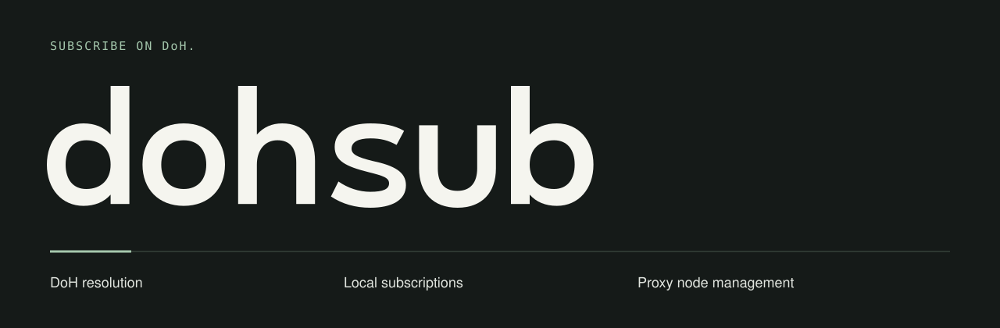
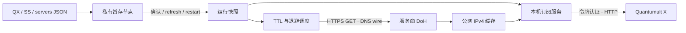
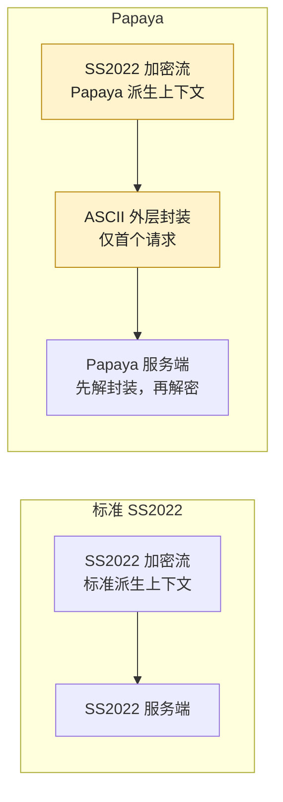

简体中文 · [English](README.md)

<p></p>

# dohsub

**私有域名解析，自动更新订阅。** 用 Rust 实现的本机常驻工具，把域名形式的 Shadowsocks 节点转为持续更新 IP 的 Quantumult X 本地订阅。



- 使用可配置的 HTTPS DoH 解析服务商私有域名，无须修改系统 DNS。
- 导入完整 QX 节点、`ss://` 链接或 servers JSON 数组，不依赖特定服务商客户端。
- 修改先保存，确认后再加载；有效 IP 尽量保持稳定，解析失败自动退避重试。
- 仅监听本机回环地址，订阅使用随机令牌；隐藏目录 `~/.dohsub/` 权限 700，私有文件权限 600。

## 安装

通过 Homebrew 安装稳定版：

```bash
brew install leo1394/dohsub/dohsub
```

Homebrew 直接下载对应平台的成品并校验 SHA256。Apple Silicon 发布包包含转接引擎，具体大小以发布附件为准，稳定版安装无须编译，也不需要 Rust/LLVM。macOS 使用系统 `curl`；Linux 需要运行时 `curl`。发布文件覆盖 macOS/Linux arm64/x86_64；macOS 发布包要求 12+（内置 Go 1.26 引擎的最低版本），Linux GNU 构建目标为 glibc 2.35+。已验证当前 Apple Silicon Mac 的原生安装，以及通过 Rosetta 执行 Intel 版本命令；Linux 原生运行和旧系统兼容性尚未验证。

已安装的用户更新：

```bash
brew update
brew upgrade leo1394/dohsub/dohsub
```

源码构建需要 **Rust 1.94+** 和 Go。

在本项目目录执行，无须 Homebrew：

```bash
./install.sh --source
export PATH="$HOME/.local/bin:$PATH"
export MANPATH="$HOME/.local/share/man:${MANPATH:-}"
```

也可以先构建，再安装可信的本地二进制：

```bash
cargo build --release --locked
./install.sh --binary ./target/release/dohsub --prefix "$HOME/.local"
```

`--binary` 信任提供的文件，不能证明下载来源。安装器会先准备二进制、手册和补全，再替换命令；保留 `bin/dohsub.previous`，安装后版本核验失败则恢复旧命令。多个配套资源不构成原子事务。

需要从 master 构建未发布代码时，显式指定 `--HEAD`（需要 Homebrew Rust 和 Go 构建工具链）：

```bash
brew install --HEAD leo1394/dohsub/dohsub
```

使用 `./install.sh --version X.Y.Z` 安装指定版本，或执行 `./install.sh` 安装最新稳定版。下载需要对应平台的二进制及同一版本的 `SHA256SUMS`；缺少发布文件时安装失败。

## 创建第一个订阅

需要可用的 DoH 地址，以及含真实加密方式和密码的完整节点配置。不要把密码、订阅令牌提交到仓库或发送到聊天。

```bash
dohsub config set --doh https://your-provider.example/dns-query
chmod 600 "$HOME/Downloads/nodes.txt"
dohsub import --file "$HOME/Downloads/nodes.txt"
dohsub start
dohsub copy-resource
```

`start` 校验 DoH 响应后启动后台进程，并打印**私有订阅地址**。`copy-resource` 把完整订阅配置行复制到剪贴板。粘贴到 QX 的 `[server_remote]`，保存并手动刷新订阅。生成的节点名称带 ` · AutoIP` 后缀；工具不会选择 QX 策略组或切换当前节点。

默认端口 **55355**。默认或缓存端口被占用时向上递增，例如其他本地服务正在使用该端口；显式 `start --port 55355` 遇到占用则失败。成功选中的端口会缓存。如果端口变化，请重新复制订阅配置行并更新 QX。

```bash
dohsub start --doh https://your-provider.example/dns-query --port 55356 --import nodes.json
dohsub config --list
dohsub config set --interface en0   # 可选：DoH 请求使用的出口网卡
dohsub config set --clear-interface
```

`config --list` 隐藏 URL 查询参数值。缓存配置的修改在下次启动或重启时生效。服务会在命令退出后继续运行，**不会自动注册开机或登录启动**。

## 常用命令

| 命令 | 行为 |
| --- | --- |
| `import --file FILE [-y]` | 从私有文件导入，逐项显示成功与失败 |
| `add [--domain HOST] [-y]` | 从剪贴板导入完整配置；全部成功后清空剪贴板 |
| `status` | 查看运行/停止状态、PID、监听地址、节点加载/发布数量及已保存配置概况；只读，不输出凭据 |
| `list` | 查看暂存节点、运行中发布数量及重试状态，不显示密码 |
| `refresh` | 加载暂存节点，并立即安排一轮 DNS 刷新；QX 仍需另外刷新 |
| `remove 'Example-US'` | 按原始名称删除、备份，运行中立即加载 |
| `restore` | 与上一次修改前的节点快照交换，运行中立即加载 |
| `restart` / `stop` | 仅管理 dohsub 后台进程 |
| `copy-resource` | 重新复制含私有令牌的本地订阅配置行 |
| `version` / `--version` | 固定两行版本和仓库地址 |
| `upgrade [-y]` | 查询 GitHub 稳定版，确认后更新受支持的安装 |
| `help config set` | 查看嵌套帮助，不初始化配置 |

按完整 tag 更新同名节点，其他已有节点保留；不同名称即使参数相同也保留，需要用 `remove` 明确删除。同一份输入中的重复 tag 会报失败。部分导入成功会保存合法节点，并返回退出码 **1**。绿色勾表示配置被接受；“已发布”表示取得公网 IPv4，都不表示已完成代理握手测试。

运行中导入会先保存，再询问是否立即加载。只有 `y`/`yes` 或 `-y` 会加载；空输入、EOF、非交互运行均仅保存。之后可执行 `refresh` 或 `restart`。`start --import FILE` 启动失败时，已接受的节点可能保留为暂存状态，不会误报服务启动成功。

[输入格式示例与架构](docs/design.md)。`restore` 只恢复节点，不恢复配置或 DNS 缓存。

## 资源与安全边界



使用阻塞 I/O，等待下一次 DNS 截止时间或控制请求；相同域名合并解析。读取订阅不触发 DNS 查询。只有到期解析时才短暂启动 `curl`，没有常驻 TLS 客户端进程。[调度与持久化说明](docs/design.md)。

原生订阅支持 Shadowsocks、公网 IPv4 和 RFC 8484 GET DNS-wire DoH 接口。可选的独立转接引擎支持标准 SS2022/Papaya TCP，并与原生节点共用订阅。TLS 证书校验保持开启；工具不配置 TUN、不修改系统 DNS，也不修改 Tailscale。

节点和 DoH 地址存放在仅当前用户可读的明文文件中，并非 Keychain 或保险库。掌握订阅地址或当前系统账号的人能读取节点密码，请勿把地址贴进日志。HTTP 拒绝外部 Host/Origin，不适合直接暴露到局域网或公网。解析失败时仅发布仍有可用地址的节点；全部不可用时返回 HTTP 503，让客户端保留旧订阅。原生节点之前解析的 IP 最多允许在 TTL 过期后继续使用 15 分钟；转接上游地址只在 TTL 内使用。

剪贴板在 macOS 使用 `pbpaste`/`pbcopy`；Linux 使用 `wl-paste`/`wl-copy` 或 `xclip`，依赖图形会话。

## 帮助、手册与补全

```bash
dohsub --help
dohsub help import
man dohsub
```

安装器和 Formula 均安装 Bash/Zsh/Fish 补全；不会修改 shell 启动文件，需要自行启用：

```bash
# Bash
source "$HOME/.local/share/bash-completion/completions/dohsub"
# Zsh：放在 ~/.zshrc 的 compinit 之前
fpath=("$HOME/.local/share/zsh/site-functions" $fpath)
autoload -Uz compinit && compinit
# Fish
source "$HOME/.local/share/fish/vendor_completions.d/dohsub.fish"
```

Homebrew 使用自身的手册和补全目录。独立安装可指定 `--prefix 绝对路径`，相应调整 PATH、MANPATH、补全路径；MANPATH 尾部保留冒号，继续搜索系统手册。

`upgrade` 使用 HTTPS 查询稳定版，按 SemVer 比较，排除预发布版本，不自动降级。取消升级成功退出且不修改安装；非交互更新需要 `--yes`。发布元数据缺失、无效或网络查询失败会报错。Homebrew 安装由对应 Formula 更新；Formula 落后于上游时明确停止。独立安装要求安装器的归属标记及匹配的 SHA256。直接运行源码目录二进制时请手动重新构建、安装。[发布清单](docs/releasing.md)。

## 开发验证

```bash
cargo test --locked
cargo build --locked
python3 tests/behavior.py
python3 tests/completion.py
```

行为测试使用临时配置和安装目录、虚构节点、模拟 DoH/Release、回环监听，不修改现有本地服务或真实 QX 设置。补全测试会报告缺失的 shell。可通过 `DOHSUB_TEST_BINARY` 指定 Release 二进制，通过 `DOHSUB_HOME` 隔离所有运行状态。

[本次验证结果](docs/validation.md)。

提交修改时附上必要的行为验证，不把凭据写入测试。Rust 程序使用 [MIT 许可证](LICENSE)，内置独立引擎使用 [GPL-3.0-or-later](relay-engine/LICENSE)。

## 协议转接（开发构建）

源码构建需要 Rust 和 Go。Cargo 将对应平台的独立 GPL 转接引擎内置到主程序；
稳定版二进制安装不需要编译器：

```bash
cargo build --release --locked
```

使用开发构建的 `target/release/dohsub import --file FILE` 导入权限为 600 的
Papaya/SS2022 节点 JSON 数组。节点采用合并导入，不清空已有配置。
每个转接节点使用稳定的回环监听端口及独立认证，固定连接该上游。
转接配置变化后需要 `target/release/dohsub restart`；配置未变时可正常刷新。
端口冲突会阻止启动，不会改选其他上游。原生 Shadowsocks 节点及 AutoIP 输出保持兼容。

转接引擎支持标准 SS2022 与默认 Papaya 参数的 TCP CONNECT，不支持的参数会报错。
需要显式指定物理 `--interface`，以及以 IP 为主机地址的 HTTPS DoH 端点，
证书校验保持开启。上游经 DoH 解析，缓存只在 TTL 内有效，IPv4 连接绑定指定接口。
解析或绑定失败时不会回退到系统 DNS 或未绑定的连接。这能降低 TUN 回环风险；
与具体隧道产品的独立性仍需验证实际路由。

生成的转接节点禁用 UDP，不自动换节点或回退直连。每节点最多 32 个并发连接，
单连接最长五分钟。引擎入口失效时不再向新订阅发布，重启服务可尝试恢复。

转接入口仅绑定 `127.0.0.1`，因此 QX 必须运行在同一台 Mac 上。
发布二进制内置转接引擎，运行时释放到私有状态目录，以内容摘要命名并校验。
可运行 `dohsub relay-license` 查看许可证。
Linux 的接口绑定可能需要 `SO_BINDTODEVICE` 权限，失败时不会回退未绑定连接。
独立引擎使用 GPL-3.0-or-later，见 `relay-engine/LICENSE` 和 `relay-engine/UPSTREAM.md`。

## 显式协议与统一订阅

DoH 是域名解析方式，不是节点传输协议。节点使用 `protocol` 指定协议，
使用 `delivery` 指定订阅输出方式；QX 独立负责业务流量分流。

| protocol | delivery | dohsub 的处理 | QX 收到的节点 |
| --- | --- | --- | --- |
| `shadowsocks` | `native` | 原有 DoH / IP 刷新 | Shadowsocks |
| `ss2022` | `native` | 原有 DoH / IP 刷新，保持标准协议 | Shadowsocks 2022 |
| `ss2022` | `relay` | 独立引擎执行标准 SS2022 TCP 握手 | 本地认证 SOCKS5 |
| `papaya` | `relay` | 独立引擎执行 Papaya TCP 协议 | 本地认证 SOCKS5 |

默认情况下 `shadowsocks` / `ss2022` 使用 `native`，`papaya` 使用 `relay`。
不支持的协议、组合或参数会报错。旧版 `hostname/encryption/password` JSON、
QX Shadowsocks 文本、`ss://` 继续兼容。Papaya 输入使用 `protocol: papaya`，
这是独立的协议变体，不是标准 SS2022。

一个私有 JSON 数组可以同时包含以下配置。示例密钥仅为占位，需替换成真实节点密钥：

```json
[
  {
    "protocol": "shadowsocks", "delivery": "native",
    "host": "legacy.example.com", "port": 443,
    "method": "chacha20-ietf-poly1305", "password": "REPLACE_ME",
    "alias": "Legacy"
  },
  {
    "id": 102, "protocol": "ss2022", "delivery": "native",
    "host": "standard.example.com", "port": 443,
    "method": "2022-blake3-aes-128-gcm",
    "password": "AAAAAAAAAAAAAAAAAAAAAA==", "alias": "SS2022 native"
  },
  {
    "id": 103, "protocol": "ss2022", "delivery": "relay",
    "host": "standard-relay.example.com", "port": 443,
    "method": "2022-blake3-aes-128-gcm",
    "password": "AAAAAAAAAAAAAAAAAAAAAA==", "alias": "SS2022 relay"
  },
  {
    "id": 104, "protocol": "papaya", "delivery": "relay",
    "host": "papaya.example.com", "port": 443,
    "alias": "Papaya", "params": {},
    "auth": {
      "server_key": "AAAAAAAAAAAAAAAAAAAAAA==",
      "user_key": "AAAAAAAAAAAAAAAAAAAAAA=="
    }
  }
]
```

标准 SS2022 当前支持 `2022-blake3-aes-128-gcm` 和 `2022-blake3-aes-256-gcm`；
Base64 解码后每个密钥分别必须是 16 或 32 字节。扩展身份头使用
`password: "server_key:user_key"`，也支持标准单密钥形式。

```bash
chmod 600 nodes.json
./target/release/dohsub import --file nodes.json
./target/release/dohsub restart
```

转接节点 `id` 必须在同协议的导入集合中保持唯一且稳定。重新导入时按协议与 ID
匹配并保留已有监听端口、入口认证和订阅名称；文件未列出的节点不自动删除。
所有节点共用原订阅 URL。每个 SOCKS5 入口固定一个上游，没有自动换节点或直连回退。
原生 SS2022 仍由 QX 握手，具体客户端兼容性应单独验证。

转接节点备份可使用 `listener` 对象指定 `port`、`username`、`password`、`tag`，
以便在全新状态目录恢复相同入口。该配置包含私有凭据；监听仍限定为回环地址，
未知入口字段会被拒绝。重新导入已有节点时保留当前入口设置。

## Papaya 协议处理流程

Papaya 基于 SS2022 TCP 加密流与扩展身份头，使用独立的密钥派生上下文，
并对首个加密请求增加 ASCII 封装。服务端与客户端必须使用一致的派生参数和封装格式。



ASCII 外层封装只用于首个加密请求；后续请求数据和响应不重复使用该封装。

1. **准备密钥与目标地址**：将服务端 PSK 和用户 PSK 从 Base64 解码为原始密钥。
   `2022-blake3-aes-128-gcm` 对应 16 字节密钥，
   `2022-blake3-aes-256-gcm` 对应 32 字节密钥。请求包含最终目标地址和端口。
2. **构造加密请求**：生成连接随机盐，构造 SS2022 扩展身份头及加密请求头。
   身份密钥使用 BLAKE3 上下文 `papaya v1 identity subkey` 派生；
   会话密钥使用 `papaya v1 session subkey` 派生。
   请求头携带协议所需的时间戳、目标地址与内层填充信息。
3. **构造外层首包头**：生成 6 字节随机 nonce。构造 9 字节头，依次包含
   1 字节版本号 `1`、4 字节大端请求长度、4 字节大端外层填充长度。
   将服务端 PSK 与 nonce 拼接，使用 BLAKE3 上下文
   `papaya v1 envelope header mask` 派生掩码，取前 9 字节与该头逐字节异或。
4. **编码并发送首包**：按顺序拼接 `nonce + 掩码头 + 原始加密请求 + 外层填充`，
   使用字母表 `0123456789abcdefghijklmnopqrstuvwxyzABCDEFGHIJKLMNOPQRSTUVWXYZ-_`
   进行 Base64 编码，不添加 `=`，随后发送编码结果。
   外层填充与 SS2022 请求内部的填充相互独立。
5. **传输后续数据**：上述 ASCII 封装仅应用于首个加密请求。
   后续数据与响应使用 Papaya 派生上下文对应的 SS2022 加密流处理。
   接收端按相同参数解密并校验加密记录。

上述流程描述 TCP 传输。与标准 SS2022 相比，Papaya 的差异在于密钥派生上下文
和首包外层封装；仅使用相同加密算法或拼接双密钥不能获得协议互通。

### 服务监督

登录或开机启动应让服务管理器直接运行 `dohsub run`，监督实际服务进程。异常退出会重启，显式 `stop` 保持停止；配置了监督入口后，`start/restart` 也交给服务管理器。详见[服务监督配置](docs/supervision.md)。
