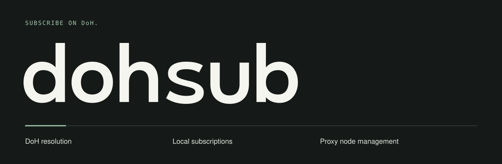
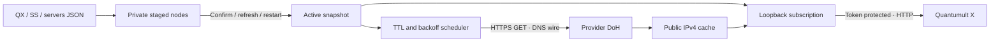

[简体中文](README-ZH.md) · English

<p></p>

# dohsub

**Private DNS in. Fresh subscriptions out.** A small Rust background service that turns hostname-based Shadowsocks nodes into an automatically updated, local Quantumult X subscription.



- Resolve provider-private hostnames through a configurable HTTPS DoH endpoint, without changing system DNS.
- Import full QX nodes, `ss://` links, or a servers JSON array. No provider application is required.
- Stage changes before loading them. Preserve still-valid IPs, honor DNS TTLs, and back off failed queries.
- Bind only to loopback, protect subscriptions with a random token, and keep private state in `~/.dohsub/` (directory 700, files 600).

## Install

The project version is recorded in [VERSION.txt](VERSION.txt); Cargo package metadata must match it.

macOS/Linux, arm64/x86_64; `curl` is needed for HTTPS. Build using Rust **1.94+**. This version has been tested on the current Apple Silicon Mac only. Linux and older OS/runtime compatibility remain unverified.

From this local checkout, without Homebrew:

```bash
./install.sh --source
export PATH="$HOME/.local/bin:$PATH"
export MANPATH="$HOME/.local/share/man:${MANPATH:-}"
```

Or build first and install a trusted local binary:

```bash
cargo build --release --locked
./install.sh --binary ./target/release/dohsub --prefix "$HOME/.local"
```

`--binary` trusts the supplied file; it cannot establish release checksum provenance. The installer stages the binary and generated resources before replacement, saves `bin/dohsub.previous`, and restores it if final verification fails. Resource updates are not a multi-file atomic transaction.

The included **HEAD-only** Formula builds from the master branch:

```bash
brew install --HEAD leo1394/dohsub/dohsub
```

Use `./install.sh --version X.Y.Z` to install a specific release, or `./install.sh` for the latest stable release. Downloads require the matching platform binary and `SHA256SUMS`; missing release assets cause installation to fail.

## First subscription

You need a valid DoH URL and a node configuration containing the real method/password. Do not send credentials to a chat or commit them to this repository.

```bash
dohsub config set --doh https://your-provider.example/dns-query
chmod 600 "$HOME/Downloads/nodes.txt"
dohsub import --file "$HOME/Downloads/nodes.txt"
dohsub start
dohsub copy-resource
```

`start` validates the DoH response, launches the background service, and prints its **private** subscription URL. `copy-resource` copies the full subscription line. Paste it into QX's `[server_remote]`, save, and refresh that subscription. New tags end in ` · AutoIP`. This does not select a QX policy group or change its current node.

The default port is **55355**. An occupied default/cached port increments to the next free port (for example when another local service uses it). An explicit `start --port 55355` collision fails. The successfully selected port is cached. If the port changes, copy the resource line again and update QX.

```bash
dohsub start --doh https://your-provider.example/dns-query --port 55356 --import nodes.json
dohsub config --list
dohsub config set --interface en0   # optional outgoing DoH interface
dohsub config set --clear-interface
```

`config --list` redacts URL query values. Cached setting changes apply at next start/restart. The service keeps running after CLI exit but is **not** registered for login/boot startup.

## Everyday commands

| Command | Behavior |
| --- | --- |
| `import --file FILE [-y]` | Import a private file; print each accepted/rejected item |
| `add [--domain HOST] [-y]` | Import full configuration from clipboard; clear it after complete success |
| `list` | Show staged nodes, active publication counts and retry state; no passwords |
| `refresh` | Load staged nodes and queue one immediate DNS round; refresh QX separately |
| `remove 'Example-US'` | Remove exact original tag, back up, and reload if running |
| `restore` | Swap nodes with the one-level previous snapshot; reload if running |
| `restart` / `stop` | Manage only the dohsub daemon |
| `copy-resource` | Copy the token-bearing local QX subscription line |
| `version` / `--version` | Exactly two lines of version/repository metadata |
| `upgrade [-y]` | Check stable GitHub releases; confirm before updating an owned installation |
| `help config set` | Nested help without initializing state |

Imports upsert by exact tag. Other existing nodes remain; different names are retained even when parameters match. Use `remove` explicitly. Within one input, duplicate tags are reported as failures. Partial imports save accepted nodes and exit **1**. “Accepted” validates syntax; “published” means a public IPv4 is available. Neither is a proxy handshake test.

When running, imports save the staged file first, then ask whether to load it. Only `y`/`yes` or `-y` loads immediately. Empty input, EOF, and noninteractive use leave it staged. `refresh` or `restart` loads later. A failed `start --import FILE` can leave accepted nodes staged; it never claims the service started.

See [input examples and architecture](docs/design.md). `restore` restores nodes, not configuration or DNS cache.

## Cost and security boundaries



The daemon uses blocking I/O and sleeps until the next DNS deadline or a control request. Each unique hostname is resolved once per due round; subscription requests never cause DNS queries. `curl` runs only during due HTTPS requests, so no TLS client process stays resident. See [scheduling and state](docs/design.md).

Only Shadowsocks, public IPv4 addresses, and RFC 8484 GET DNS-wire endpoints are supported. TLS certificate validation stays enabled. This is a subscription generator, not a proxy client, DNS server, traffic router, or connectivity checker. There is no TUN, system DNS change, or interference with Tailscale.

The private endpoint URL and nodes are plaintext in owner-only files, not a keychain/vault. Anyone with the subscription URL or access as your OS user can read credentials. Avoid copying the URL into logs. The HTTP endpoint rejects foreign Host/Origin headers; it is not intended to be exposed to LAN/Internet clients. Failed resolutions publish only available nodes; HTTP 503 when none are available lets clients retain their last subscription. A previously resolved IP may be used for up to 15 minutes after TTL expiry.

Clipboard requires `pbpaste`/`pbcopy` on macOS; Linux uses `wl-paste`/`wl-copy` or `xclip`. Availability depends on a graphical session.

## Help, manuals and completion

```bash
dohsub --help
dohsub help import
man dohsub
```

The installer and Formula install Bash, Zsh and Fish completions. Enable the current shell explicitly; no startup file is edited:

```bash
# Bash
source "$HOME/.local/share/bash-completion/completions/dohsub"
# Zsh: place before compinit in ~/.zshrc
fpath=("$HOME/.local/share/zsh/site-functions" $fpath)
autoload -Uz compinit && compinit
# Fish
source "$HOME/.local/share/fish/vendor_completions.d/dohsub.fish"
```

Homebrew uses its own completion/man directories. Standalone installs support `--prefix ABSOLUTE_DIR`; adjust PATH, MANPATH and completion paths accordingly. Preserve MANPATH's trailing colon to retain system manuals.

`upgrade` checks stable SemVer releases over HTTPS, excludes prereleases, and never silently downgrades. Cancellation succeeds without installation changes; a noninteractive update needs `--yes`. Missing or invalid release metadata is an error. Homebrew updates use the owning Formula only and fail if it lags upstream; standalone updates require the installer ownership marker and matching SHA256. Source-checkout binaries require manual rebuild/install. [Release checklist](docs/releasing.md).

## Development

```bash
cargo test --locked
cargo build --locked
python3 tests/behavior.py
python3 tests/completion.py
```

Behavior tests use temporary state/install directories, synthetic nodes, a mocked DoH/release backend, and loopback listeners. They do not modify existing local services or real QX settings. Completion tests report unavailable shells. Set `DOHSUB_TEST_BINARY` to test a release binary. Set `DOHSUB_HOME` to isolate all runtime state.

[Local validation results](docs/validation.md).

Contributions should include focused behavior checks and keep secrets out of fixtures. [MIT license](LICENSE).
