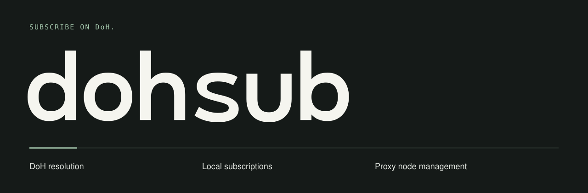
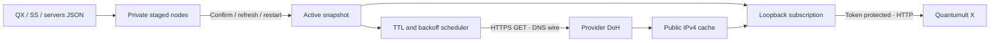
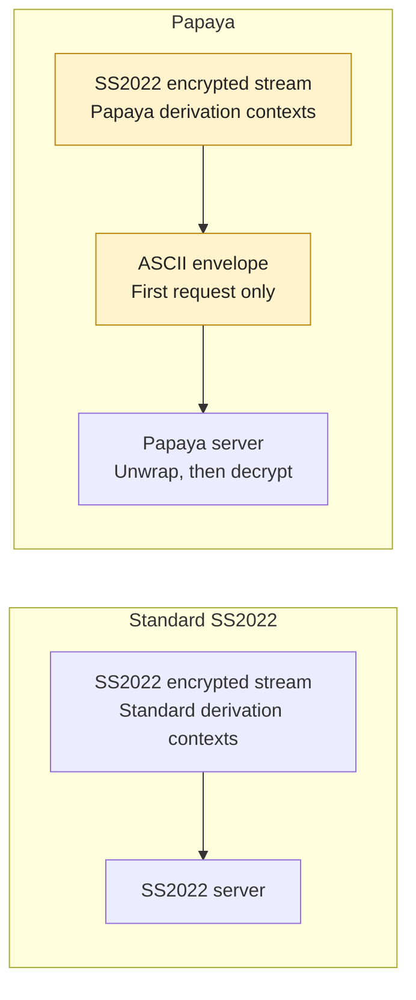

[简体中文](README-ZH.md) · English

<p></p>

# dohsub

**Private DNS in. Fresh subscriptions out.** A small Rust background service that turns hostname-based Shadowsocks nodes into an automatically updated, local Quantumult X subscription.



- Resolve provider-private hostnames through a configurable HTTPS DoH endpoint, without changing system DNS.
- Import full QX nodes, `ss://` links, or a servers JSON array. No provider application is required.
- Stage changes before loading them. Preserve still-valid IPs, honor DNS TTLs, and back off failed queries.
- Bind only to loopback, protect subscriptions with a random token, and keep private state in `~/.dohsub/` (directory 700, files 600).

## Install

Install the stable release with Homebrew:

```bash
brew install leo1394/dohsub/dohsub
```

Homebrew downloads the matching precompiled binary and verifies its SHA256. Release binaries bundle the relay engine; stable installs do not compile source or require Rust, Go, or LLVM. macOS uses the system `curl`; Linux requires `curl` at runtime. Releases cover macOS/Linux arm64/x86_64. Release packages require macOS 12+ (the bundled Go 1.26 relay minimum); Linux GNU builds target glibc 2.35+. Native installation is verified on the current Apple Silicon Mac; Intel version execution is verified through Rosetta, and native Linux/older OS runtime compatibility remains unverified.

To update an existing Homebrew install:

```bash
brew update
brew upgrade leo1394/dohsub/dohsub
```

Source builds require Rust **1.94+** and Go.

From this local checkout, without Homebrew:

```bash
./install.sh --source
export PATH="$HOME/.local/bin:$PATH"
export MANPATH="$HOME/.local/share/man:${MANPATH:-}"
```

Or build first and install a trusted local binary:

```bash
cargo build --release --locked
./install.sh --binary ./target/release/dohsub --prefix "$HOME/.local"
```

`--binary` trusts the supplied file; it cannot establish release checksum provenance. The installer stages the binary and generated resources before replacement, saves `bin/dohsub.previous`, and restores it if final verification fails. Resource updates are not a multi-file atomic transaction.

To build unreleased changes from master with Homebrew, explicitly request `--HEAD` (requires the Homebrew Rust and Go build toolchains):

```bash
brew install --HEAD leo1394/dohsub/dohsub
```

Use `./install.sh --version X.Y.Z` to install a specific release, or `./install.sh` for the latest stable release. Downloads require the matching platform binary and `SHA256SUMS`; missing release assets cause installation to fail.

## First subscription

You need a valid DoH URL and a node configuration containing the real method/password. Do not send credentials to a chat or commit them to this repository.

```bash
dohsub config set --doh https://your-provider.example/dns-query
chmod 600 "$HOME/Downloads/nodes.txt"
dohsub import --file "$HOME/Downloads/nodes.txt"
dohsub start
dohsub copy-resource
```

`start` validates the DoH response, launches the background service, and prints its **private** subscription URL. `copy-resource` copies the full subscription line. Paste it into QX's `[server_remote]`, save, and refresh that subscription. New tags end in ` · AutoIP`. This does not select a QX policy group or change its current node.

The default port is **55355**. An occupied default/cached port increments to the next free port (for example when another local service uses it). An explicit `start --port 55355` collision fails. The successfully selected port is cached. If the port changes, copy the resource line again and update QX.

```bash
dohsub start --doh https://your-provider.example/dns-query --port 55356 --import nodes.json
dohsub config --list
dohsub config set --interface en0   # optional outgoing DoH interface
dohsub config set --clear-interface
```

`config --list` redacts URL query values. Cached setting changes apply at next start/restart. The service keeps running after CLI exit but is **not** registered for login/boot startup. For supervised login/boot startup, use `dohsub run` as the foreground process; see [Service supervision](docs/supervision.md).

## Everyday commands

| Command | Behavior |
| --- | --- |
| `import --file FILE [-y]` | Import a private file; print each accepted/rejected item |
| `add [--domain HOST] [-y]` | Import full configuration from clipboard; clear it after complete success |
| `status` | Show running/stopped state, PID, listener, active/published node counts and saved configuration; read-only, no credentials |
| `list` | Show staged nodes, active publication counts and retry state; no passwords |
| `refresh` | Load staged nodes and queue one immediate DNS round; refresh QX separately |
| `remove 'Example-US'` | Remove exact original tag, back up, and reload if running |
| `restore` | Swap nodes with the one-level previous snapshot; reload if running |
| `restart` / `stop` | Manage only the dohsub daemon |
| `copy-resource` | Copy the token-bearing local QX subscription line |
| `version` / `--version` | Exactly two lines of version/repository metadata |
| `upgrade [-y]` | Check stable GitHub releases; confirm before updating an owned installation |
| `help config set` | Nested help without initializing state |

Imports upsert by exact tag. Other existing nodes remain; different names are retained even when parameters match. Use `remove` explicitly. Within one input, duplicate tags are reported as failures. Partial imports save accepted nodes and exit **1**. “Accepted” validates syntax; “published” means a public IPv4 is available. Neither is a proxy handshake test.

When running, imports save the staged file first, then ask whether to load it. Only `y`/`yes` or `-y` loads immediately. Empty input, EOF, and noninteractive use leave it staged. `refresh` or `restart` loads later. A failed `start --import FILE` can leave accepted nodes staged; it never claims the service started.

See [input examples and architecture](docs/design.md). `restore` restores nodes, not configuration or DNS cache.

## Cost and security boundaries



The daemon uses blocking I/O and sleeps until the next DNS deadline or a control request. Each unique hostname is resolved once per due round; subscription requests never cause DNS queries. `curl` runs only during due HTTPS requests, so no TLS client process stays resident. See [scheduling and state](docs/design.md).

Native subscriptions support Shadowsocks with public IPv4 addresses and RFC 8484 GET DNS-wire endpoints. The optional Papaya TCP relay helper publishes authenticated loopback SOCKS5 entries alongside native nodes. TLS certificate validation stays enabled. The Rust daemon generates subscriptions; an optional separate relay helper handles fixed-upstream SS2022/Papaya TCP connections. It is not a DNS server or traffic policy router. There is no TUN, system DNS change, or interference with Tailscale.

The private endpoint URL and nodes are plaintext in owner-only files, not a keychain/vault. Anyone with the subscription URL or access as your OS user can read credentials. Avoid copying the URL into logs. The HTTP endpoint rejects foreign Host/Origin headers; it is not intended to be exposed to LAN/Internet clients. Failed resolutions publish only available nodes; HTTP 503 when none are available lets clients retain their last subscription. A native node's previously resolved IP may be used for up to 15 minutes after TTL expiry; relay upstream addresses are used only within their TTL.

Clipboard requires `pbpaste`/`pbcopy` on macOS; Linux uses `wl-paste`/`wl-copy` or `xclip`. Availability depends on a graphical session.

## Help, manuals and completion

```bash
dohsub --help
dohsub help import
man dohsub
```

The installer and Formula install Bash, Zsh and Fish completions. Enable the current shell explicitly; no startup file is edited:

```bash
# Bash
source "$HOME/.local/share/bash-completion/completions/dohsub"
# Zsh: place before compinit in ~/.zshrc
fpath=("$HOME/.local/share/zsh/site-functions" $fpath)
autoload -Uz compinit && compinit
# Fish
source "$HOME/.local/share/fish/vendor_completions.d/dohsub.fish"
```

Homebrew uses its own completion/man directories. Standalone installs support `--prefix ABSOLUTE_DIR`; adjust PATH, MANPATH and completion paths accordingly. Preserve MANPATH's trailing colon to retain system manuals.

`upgrade` checks stable SemVer releases over HTTPS, excludes prereleases, and never silently downgrades. Cancellation succeeds without installation changes; a noninteractive update needs `--yes`. Missing or invalid release metadata is an error. Homebrew updates use the owning Formula only and fail if it lags upstream; standalone updates require the installer ownership marker and matching SHA256. Source-checkout binaries require manual rebuild/install. [Release checklist](docs/releasing.md).

## Development

```bash
cargo test --locked
cargo build --locked
python3 tests/behavior.py
python3 tests/completion.py
```

Behavior tests use temporary state/install directories, synthetic nodes, a mocked DoH/release backend, and loopback listeners. They do not modify existing local services or real QX settings. Completion tests report unavailable shells. Set `DOHSUB_TEST_BINARY` to test a release binary. Set `DOHSUB_HOME` to isolate all runtime state.

[Local validation results](docs/validation.md).

Contributions should include focused behavior checks and keep secrets out of fixtures. The Rust application uses the [MIT license](LICENSE); the bundled independent relay uses [GPL-3.0-or-later](relay-engine/LICENSE).

## Protocol relay (development build)

Source builds require Rust and Go. Cargo bundles the platform-specific GPL relay
engine in the main executable; stable binary installs require neither compiler:

```bash
cargo build --release --locked
```

Import a private, mode-600 Papaya/SS2022 servers JSON array with the development
`target/release/dohsub import --file FILE`. Existing tags are merged, never cleared.
Each relayed node gets a stable loopback port derived from its upstream identity
and an independent authenticated SOCKS5 endpoint, always bound to that upstream.
Importing relay changes requires `target/release/dohsub restart`; refresh supports
unchanged relay configurations. Port collisions fail startup rather than select
another upstream. Standard Shadowsocks nodes and their AutoIP output remain intact.

The helper supports standard SS2022 and default Papaya parameters over TCP CONNECT.
Unknown parameters are rejected. Relay mode requires an explicit physical `--interface`
and an IP-literal HTTPS DoH endpoint (certificate checks remain enabled). Upstream
addresses are resolved through DoH, cached only until TTL expiry, and connected
using interface-bound IPv4 sockets. Resolution or binding failures never fall back
to system DNS or an unbound socket. This reduces TUN recursion risk; independence
from a particular packet-tunnel product still requires route-level verification.
UDP is disabled in generated entries; no automatic
node switching or direct fallback occurs. Connections have a five-minute lifetime
limit and each relay accepts up to 32 concurrent clients. A dead helper's endpoint
is withheld from new subscriptions; restart the daemon to recover it.

QX must run on the same Mac because relay listeners bind only to 127.0.0.1.
Release binaries include the relay engine. It is extracted into the private state
directory with a content-derived filename and verified before execution.
Use `dohsub relay-license` to read its license.
On Linux, interface binding may require permission for `SO_BINDTODEVICE`; failure does not fall back to an unbound socket.
The helper is GPL-3.0-or-later; see relay-engine/LICENSE and UPSTREAM.md.

## Explicit protocols and unified subscriptions

DoH resolves names; it is not a proxy transport protocol. Use `protocol` to select
the upstream protocol and `delivery` to select how the node is exposed. QX remains
responsible for traffic routing.

| protocol | delivery | dohsub behavior | QX receives |
| --- | --- | --- | --- |
| `shadowsocks` | `native` | DoH resolution and IP refresh | Shadowsocks |
| `ss2022` | `native` | DoH/IP refresh with standard protocol settings | Shadowsocks 2022 |
| `ss2022` | `relay` | Independent standard SS2022 TCP engine | Authenticated local SOCKS5 |
| `papaya` | `relay` | Independent Papaya TCP engine | Authenticated local SOCKS5 |

`shadowsocks` and `ss2022` default to `native`; `papaya` defaults to `relay`.
Unsupported protocols, combinations, and relay parameters fail explicitly.
Legacy `hostname/encryption/password` JSON, QX Shadowsocks text, and `ss://` remain
supported. Papaya inputs use `protocol: papaya`; this is a distinct protocol variant.

A private JSON array can contain all these node types. Replace the example keys
and credentials with the actual node credentials:

```json
[
  {
    "protocol": "shadowsocks", "delivery": "native",
    "host": "legacy.example.com", "port": 443,
    "method": "chacha20-ietf-poly1305", "password": "REPLACE_ME",
    "alias": "Legacy"
  },
  {
    "id": 102, "protocol": "ss2022", "delivery": "native",
    "host": "standard.example.com", "port": 443,
    "method": "2022-blake3-aes-128-gcm",
    "password": "AAAAAAAAAAAAAAAAAAAAAA==", "alias": "SS2022 native"
  },
  {
    "id": 103, "protocol": "ss2022", "delivery": "relay",
    "host": "standard-relay.example.com", "port": 443,
    "method": "2022-blake3-aes-128-gcm",
    "password": "AAAAAAAAAAAAAAAAAAAAAA==", "alias": "SS2022 relay"
  },
  {
    "id": 104, "protocol": "papaya", "delivery": "relay",
    "host": "papaya.example.com", "port": 443,
    "alias": "Papaya", "params": {},
    "auth": {
      "server_key": "AAAAAAAAAAAAAAAAAAAAAA==",
      "user_key": "AAAAAAAAAAAAAAAAAAAAAA=="
    }
  }
]
```

Standard SS2022 supports `2022-blake3-aes-128-gcm` and `2022-blake3-aes-256-gcm`.
Each Base64-decoded key must be 16 or 32 bytes, respectively. Extended identity
headers use `password: "server_key:user_key"`; single-key configurations also work.

```bash
chmod 600 nodes.json
./target/release/dohsub import --file nodes.json
./target/release/dohsub restart
```

A relay node's `id` must be unique and stable within its protocol. Reimports match
by protocol and ID, preserving listener ports, entry credentials, and subscription
names. Existing nodes omitted from an import are not deleted. All nodes share the
same subscription URL. Each SOCKS5 entry has exactly one upstream, with no automatic
node switching or direct fallback. Native SS2022 handshakes are performed by QX;
client compatibility must be verified separately.

Relay backups may include a `listener` object with `port`, `username`, `password`,
and `tag` to restore an entry unchanged into a fresh state directory. These fields
contain private credentials. Listeners remain loopback-only; unknown listener
fields are rejected. Reimporting an existing node preserves its current entry.

## Papaya protocol flow

Papaya uses the SS2022 TCP encrypted stream and extensible identity headers, with
distinct key-derivation contexts and an ASCII envelope around the first encrypted
request. Both peers must agree on the derivation parameters and envelope format.



The ASCII envelope applies only to the first encrypted request; subsequent request
data and responses do not repeat this envelope.

1. **Prepare keys and destination.** Base64-decode the server PSK and user PSK.
   `2022-blake3-aes-128-gcm` uses 16-byte keys; `2022-blake3-aes-256-gcm` uses
   32-byte keys. The request carries the final destination address and port.
2. **Construct the encrypted request.** Generate a random connection salt and
   construct the SS2022 identity and encrypted request headers. Derive identity
   keys with BLAKE3 context `papaya v1 identity subkey`, and session keys with
   `papaya v1 session subkey`. Request headers carry the required timestamp,
   destination, and inner padding information.
3. **Construct the outer header.** Generate a random 6-byte nonce. Build a 9-byte
   header containing version byte `1`, a 4-byte big-endian request length, and a
   4-byte big-endian outer padding length. Concatenate the server PSK and nonce,
   derive a mask with BLAKE3 context `papaya v1 envelope header mask`, and XOR its
   first 9 bytes with the header.
4. **Encode and send the first request.** Concatenate
   `nonce + masked header + original encrypted request + outer padding`. Encode
   using Base64 alphabet `0123456789abcdefghijklmnopqrstuvwxyzABCDEFGHIJKLMNOPQRSTUVWXYZ-_`
   without `=` padding, then send the result. Outer padding is independent of
   padding inside the SS2022 request.
5. **Transfer subsequent data.** Apply the ASCII envelope only to the first
   encrypted request. Subsequent data and responses use the SS2022 encrypted
   stream with Papaya derivation contexts. The receiving peer decrypts and
   authenticates the encrypted records using the same parameters.

This flow describes TCP. Papaya differs from standard SS2022 in its key-derivation
contexts and outer first-request envelope. Using the same cipher or concatenating
two keys alone does not provide protocol interoperability.

### Relay DNS recovery

Relays retry transient DoH transport failures within a 10-second budget, refresh DNS before TTL expiry, and back off after failures. Valid cached addresses remain usable during refresh; expired, private and fake IP addresses are refused. `dohsub status` reports DNS validity and the last upstream connection outcome separately. A listening port alone does not make a relay publishable. See [DNS recovery and relay health](docs/resilience.md).
